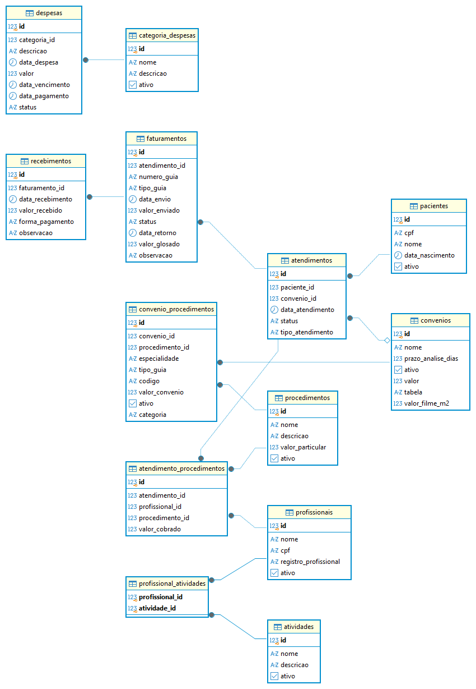

# Gestão e Faturamento de Clínica - SQL

## Sobre o projeto

Comecei esse projeto em fevereiro de 2026, pensando em uma forma de me ajudar no meu trabalho como faturista de clínica e também de colocar em prática o que estava aprendendo na faculdade.

No meu trabalho preciso acompanhar o faturamento que é lançado, os valores de consultas e exames e também as metas que são cobradas. Então tive a ideia de criar um banco de dados onde pudesse organizar essas informações e ter um controle melhor dos valores.

Também queria ir além do que estava aprendendo nas aulas, conhecer melhor o SQL e entender como funciona o desenvolvimento de um banco de dados na prática. Por isso, fui criando as tabelas, fazendo os relacionamentos, inserindo informações e testando consultas conforme o projeto foi crescendo.

Em novembro de 2026, fiz algumas alterações para conseguir compartilhar o projeto no GitHub. Substituí os dados reais por dados fictícios, mas mantive a estrutura e as regras que fazem parte do funcionamento de uma clínica.
A ideia é continuar utilizando o banco para me auxiliar no trabalho e também continuar aprendendo e melhorando o projeto conforme avanço nos meus estudos.

## Ferramentas utilizadas

- **PostgreSQL**
- **DBeaver**
- **SQL**

## Tabelas do banco

O banco possui **13 tabelas**:

- Pacientes
- Profissionais
- Atividades
- Profissional_atividades
- Procedimentos
- Atendimentos
- Atendimento_procedimentos
- Convênios
- Convenio_procedimentos
- Faturamentos
- Recebimentos
- Despesas
- Categoria_despesas

## Algumas **regras** consideradas no projeto

- Toda consulta precisa ter uma pré-consulta, com bioimpedância, glicose e oximetria.
- Cada procedimento é relacionado ao profissional responsável.
- Os valores dos procedimentos podem mudar de acordo com o convênio.
- Os atendimentos particulares utilizam valores próprios.
- Cada convênio possui seus códigos e valores de procedimentos.
- Os curativos possuem categorias diferentes: simples, intermediário e complexo.
- Os faturamentos são vinculados aos atendimentos realizados.
- Os recebimentos podem ser integrais ou parciais.
- As despesas são separadas por categorias, incluindo salários, encargos, materiais de curativos e materiais para injetáveis.

## O que pratiquei com SQL

Durante o desenvolvimento, fui praticando alguns comandos e conceitos:

- **SELECT**, **WHERE** e **ORDER BY**
- **DISTINCT** e **LIKE**
- **INNER JOIN** e **LEFT JOIN**
- **GROUP BY** e **HAVING**
- **COUNT** e **SUM**
- **CASE WHEN**
- **COALESCE**
- Subconsultas e **NOT EXISTS**
- Relacionamentos entre tabelas
- Consultas para conferir valores e buscar informações

## Consultas analíticas

Criei um arquivo separado com consultas para analisar algumas informações do banco, como:

- Faturamento total por mês.
- Faturamento por convênio.
- Comparação entre valores enviados e recebidos.
- Identificação de recebimentos parciais ou pendentes.
- Quantidade de atendimentos por tipo.
- Faturamento por procedimento.
- Despesas por categoria.
- Despesas pagas e pendentes.
- Comparação entre valores recebidos e despesas pagas.
- Faturamento por profissional.
- Quantidade de procedimentos ativos e inativos.

## Dados cadastrados

Até o momento, cadastrei:

| Informação | Quantidade |
|---|---:|
| Pacientes | 20 |
| Profissionais | 15 |
| Atividades | 12 |
| Procedimentos | 14 |
| Convênios | 45 |
| Preços por convênio e procedimento | 649 |
| Atendimentos | 100 |
| Procedimentos vinculados | 180 |
| Categorias de despesas | 12 |
| Despesas | 14 |
| Faturamentos | 81 |
| Recebimentos | 81 |

## Resultados das consultas

Também fiz consultas para acompanhar os valores de faturamento, recebimentos e despesas da clínica.

| Descrição | Valor |
|---|---:|
| Total faturado | R$ 24.671,02 |
| Total recebido | R$ 22.006,82 |
| Valor a receber | R$ 2.664,20 |
| Total de despesas | R$ 33.950,00 |
| Despesas pagas | R$ 7.270,00 |
| Despesas pendentes | R$ 26.680,00 |

Todos os dados utilizados são fictícios e foram criados para desenvolver o projeto e praticar SQL.

## Testes e validação

Depois de criar as tabelas e inserir os dados, resolvi testar se outra pessoa conseguiria montar o banco do zero utilizando os arquivos disponíveis no repositório.
Para isso, criei um novo banco de dados e executei os dois scripts. Tudo funcionou corretamente e as 13 tabelas ficaram com as quantidades de registros esperadas.
Também fiz algumas consultas com **JOIN** para conferir se os relacionamentos estavam funcionando, como entre pacientes e atendimentos, faturamentos e recebimentos, e profissionais e atividades.

## Diagrama Entidade-Relacionamento (DER)

O diagrama mostra como as tabelas do banco de dados estão relacionadas.

## Aprendizado

Esse projeto tem me ajudado a colocar em prática o que venho estudando sobre banco de dados e também tem relação com algumas situações que encontro no meu dia a dia de trabalho.

Além de aprender a criar tabelas e fazer consultas, estou entendendo melhor como relacionar informações, trabalhar com regras de negócio e utilizar SQL para conferir dados e gerar informações que podem ajudar no acompanhamento de uma empresa.

Ainda pretendo continuar desenvolvendo e melhorando o projeto conforme for aprendendo mais.
